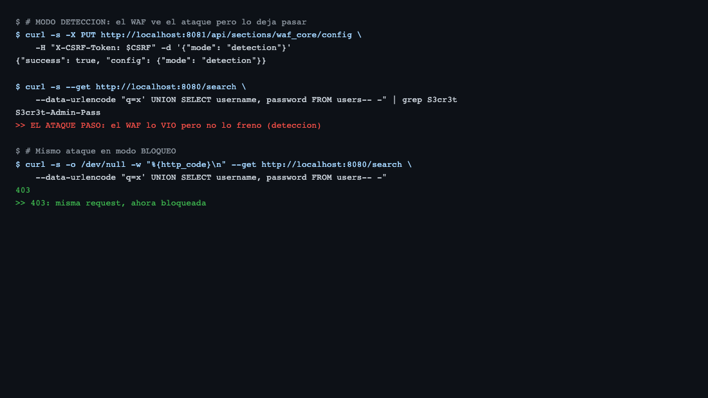
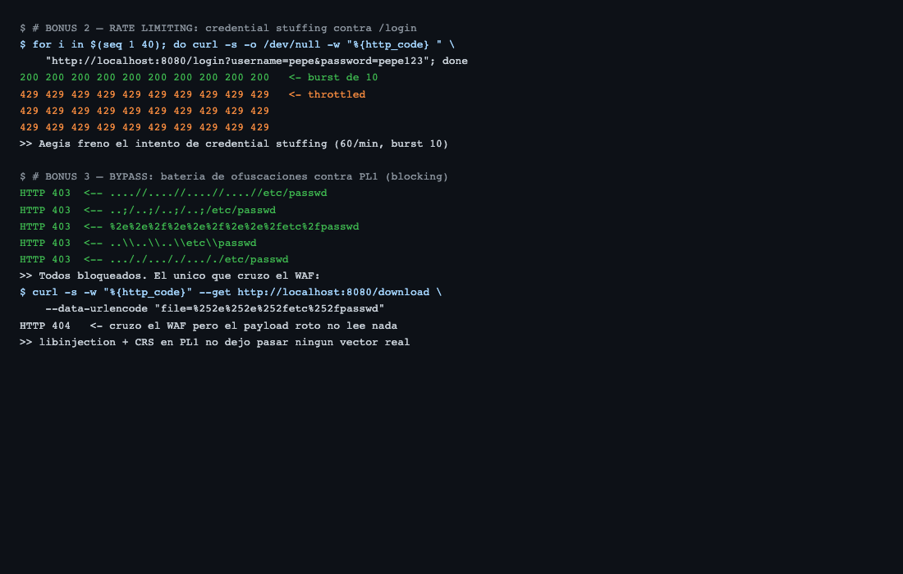
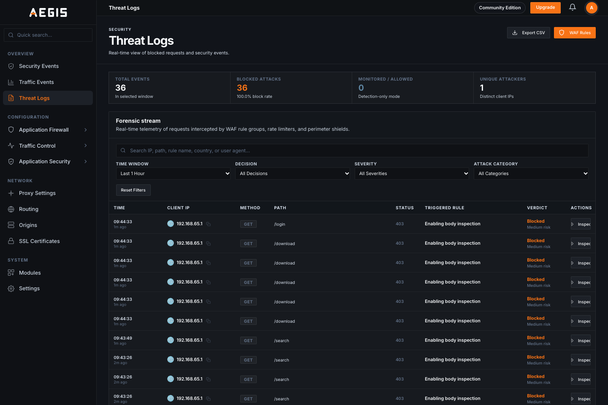
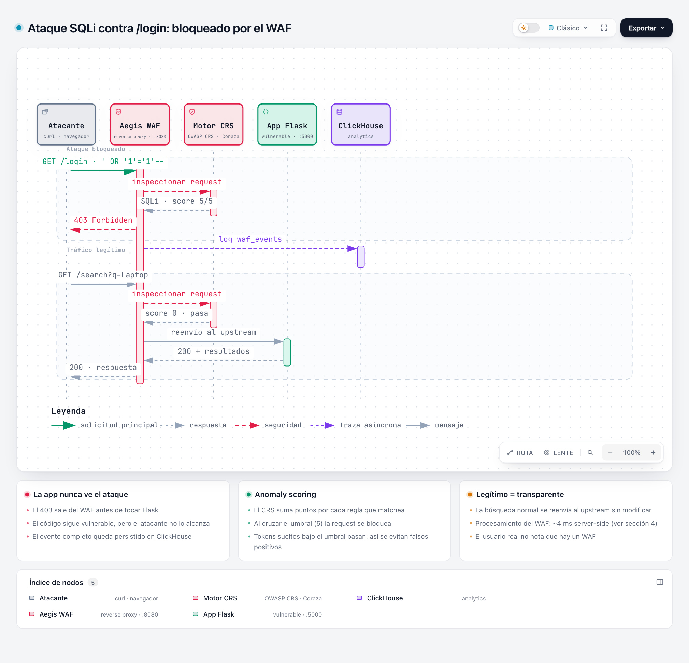
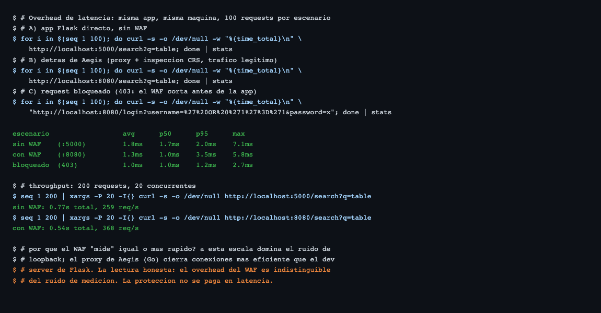
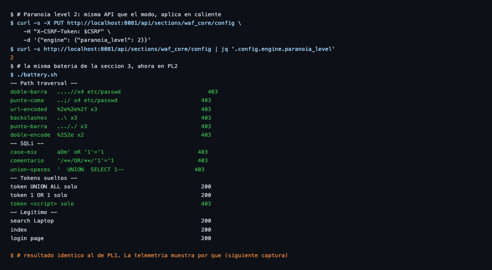
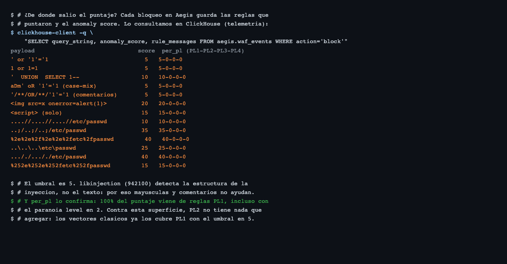
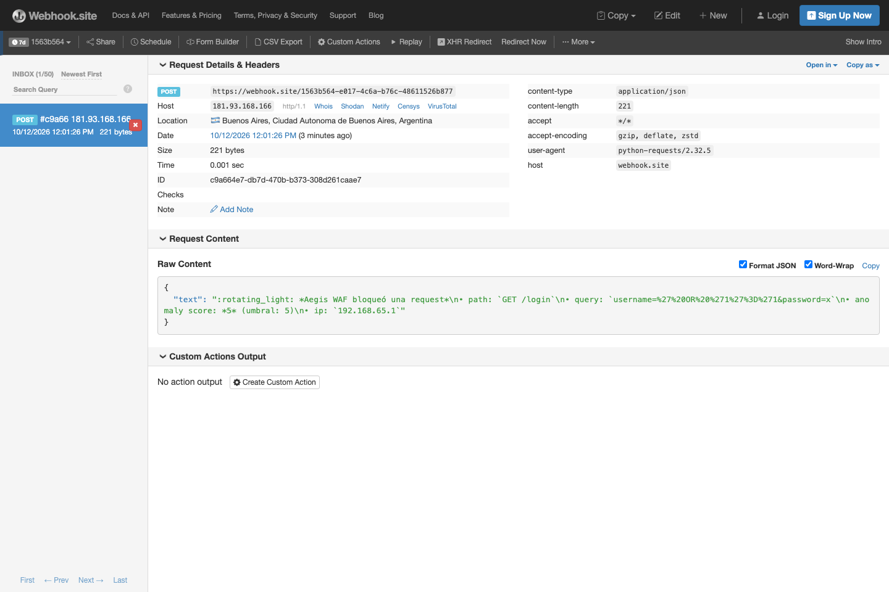

Esta es la **segunda parte** de [Montando un WAF en 10 minutos: atacando una app antes y después de Aegis](https://blog.santiagoagustinfernandez.com/montando-un-waf-en-10-minutos-atacando-una-app-antes-y-despus-de-aegis). Si no la leíste, arrancá por ahí: levantamos una app Flask deliberadamente vulnerable, la atacamos sin protección (4/4 ataques explotaron) y pusimos Aegis —un WAF open source con OWASP CRS— delante (4/4 bloqueados).

En esta parte nos ponemos del lado de quien **opera** el WAF. Siete experimentos que quedaron fuera de la línea principal pero que responden lo que cualquier equipo pregunta antes de poner uno en producción: ¿puedo deployarlo sin romper nada?, ¿frena el abuso por volumen?, ¿aguanta intentos de evasión?, ¿cuánto cuesta en latencia?, ¿qué cambia si subo el paranoia level?, ¿y cómo me entero cuando frena algo? Todo probado contra el mismo laboratorio, con el mismo formato de siempre: sentencia → captura.

El código del lab sigue en [GitHub](https://github.com/safernandez666/waf-poc): `docker compose up -d` y lo tenés corriendo.

---

## 1. Modo detección vs. modo bloqueo

El WAF tiene dos modos de operación. En **bloqueo** corta la request (403); en **detección** la deja pasar pero la registra. Cambiar de modo es una llamada a la API — se aplica en caliente, sin reiniciar nada:

```bash
curl -s -X PUT http://localhost:8081/api/sections/waf_core/config \
  -H "X-CSRF-Token: $CSRF" -d '{"mode": "detection"}'
```

Con el modo en detección, el mismo UNION que antes devolvía 403 ahora pasa y filtra la contraseña del admin:



Para qué sirve esto en la vida real: deployar el WAF en detección una o dos semanas, mirar los logs para encontrar falsos positivos sobre tu tráfico real, ajustar exclusiones, y recién entonces pasar a bloqueo. Es el rollout sensato.

> Dato de la corrida: el cambio de modo (y el de paranoia level) se hace por la API del control plane y aplica en caliente. Cambiar el `config.yaml` solo importa en el primer arranque — después la config vive en Postgres.

---

## 2. Rate limiting: credential stuffing

La config default trae rate limiting activado: 60 requests/minuto por IP, burst de 10. Simulamos un ataque de credential stuffing — 40 intentos de login seguidos, con credenciales inofensivas:

```bash
for i in $(seq 1 40); do curl -s -o /dev/null -w "%{http_code} " \
  "http://localhost:8080/login?username=pepe&password=pepe123"; done
```

Los primeros 10 pasan (burst), los siguientes 30 reciben 429. No importa que el payload sea legítimo: el WAF frena por volumen, no por contenido:



Y en Threat Logs cada bloqueo queda registrado — los últimos eventos de la captura son los 429 y los intentos de bypass:



---

## 3. Intentando el bypass (y fracasando bien)

La prueba de fuego para un WAF no es bloquear el payload del tutorial: es bloquear el payload *ofuscado*. Probamos la batería clásica de evasión contra el path traversal, en paranoia level 1:

| Técnica | Payload | Resultado |
|---------|---------|-----------|
| Doble punto con doble barra | `....//....//....//....//etc/passwd` | 403 |
| Punto-coma (Tomcat-style) | `..;/..;/..;/..;/etc/passwd` | 403 |
| URL-encoded | `%2e%2e%2f%2e%2e%2f%2e%2e%2fetc%2fpasswd` | 403 |
| Backslashes (Windows) | `..\..\..\etc\passwd` | 403 |
| Punto-punto-barra-punto | `..././..././..././etc/passwd` | 403 |
| Doble encoding | `%252e%252e%252fetc%252fpasswd` | **cruzó el WAF…** |

El doble encoding es el único que cruzó — pero por la razón equivocada: la app recibe el string ya decodificado una vez (`%2e%2e%2f`) y lo trata como un nombre de archivo literal, así que responde 404. Pasó el WAF pero el payload quedó roto: no lee nada. Como bypass real, es inútil.

Del lado SQLi ni siquiera hubo que analizar casos: `/**/` como espacio, variaciones de mayúsculas, comentarios alternativos — todo 403. El libinjection del CRS detecta la *estructura* de la inyección, no un string fijo, así que ofuscar texto no alcanza.

**Lo que sí pasó, por diseño:** tokens sueltos como `UNION ALL` o `1 OR 1` devuelven 200. El anomaly scoring los puntúa por debajo del umbral (5) y los deja pasar — así es como el CRS evita falsos positivos sobre búsquedas legítimas de un usuario. Y acá está la moraleja del experimento: **no son exploitables**. Subir el paranoia level no era necesario: PL1 con umbral 5 bastó para todo lo que probamos.

Todo el ciclo en una imagen: el ataque muere en el WAF con un 403 y queda persistido en ClickHouse; la búsqueda legítima pasa transparente y llega a Flask sin que el usuario note que hay un WAF en el medio:



---

## 4. El costo: overhead de latencia

Toda protección se paga de alguna forma. Medimos cuánto suma el WAF con 100 requests por escenario, contra la misma app en la misma máquina:

```bash
for i in $(seq 1 100); do curl -s -o /dev/null -w "%{time_total}\n" \
  http://localhost:8080/search?q=table; done | stats
```

| Escenario | avg | p50 | p95 |
|-----------|-----|-----|-----|
| Sin WAF (`:5000`) | 1.8ms | 1.7ms | 2.0ms |
| Con WAF (`:8080`) | 1.3ms | 1.0ms | 3.5ms |
| Bloqueado (403) | 1.0ms | 1.0ms | 1.2ms |



El número sorprendente es que el WAF "mide" igual o más rápido que el acceso directo. No es magia: a esta escala domina el ruido de loopback, y el proxy de Aegis (Go) cierra conexiones más eficientemente que el dev server de Flask. La lectura honesta es que **el overhead es indistinguible del ruido de medición** — con 200 requests concurrentes, el camino con WAF hasta dio más throughput (368 vs 259 req/s). Ojo con la letra chica: esto es localhost con una app de juguete; en producción el costo real es CPU de inspección por request y se mide en el entorno real. Pero el orden de magnitud es el que esperás de un proxy en Go: sub-milisegundo por request.

---

## 5. Paranoia level 2: ¿qué cambia?

El CRS se organiza en niveles de paranoia: PL1 es el default razonable; cada nivel superior agrega reglas más estrictas (y más propensas a falsos positivos). Cambiarlo es otra llamada en caliente a la misma API:

```bash
curl -s -X PUT http://localhost:8081/api/sections/waf_core/config \
  -H "X-CSRF-Token: $CSRF" \
  -d '{"engine": {"paranoia_level": 2}}'
```

Re-corrimos la batería completa de la sección 3 con PL2 activo. El resultado fue **idéntico**: mismos 403, mismos 200 en tokens sueltos, mismo tráfico legítimo pasando.



¿Por qué? La telemetría lo muestra sin lugar a dudas. Cada bloqueo de Aegis guarda el anomaly score desarmado por nivel:

```sql
SELECT query_string, anomaly_score, rule_messages
FROM aegis.waf_events WHERE action = 'block'
```



La columna `per_pl` es el puntaje desarmado (PL1-PL2-PL3-PL4), y en los 13 bloqueos de la batería el puntaje es `X-0-0-0`: **el 100% vino de reglas PL1, incluso con el nivel en 2**. Los vectores clásicos ya los cubre PL1 con el umbral en 5; las reglas de PL2 apuntan a vectores más raros y no entraron en juego. También se ve el motivo por el que la ofuscación no sirvió: los payloads SQLi puntúan 5 por libinjection (regla 942100), que detecta la *estructura* de la inyección, no el texto — cambiar mayúsculas o meter comentarios no modifica la estructura. Y los traversal apilan varias reglas (`..`, `../`, `/etc/passwd` por separado): por eso sus scores van de 10 a 40.

---

## 6. Probá vos mismo

Todo el lab corre en Docker y está en [GitHub](https://github.com/safernandez666/waf-poc). Tres comandos y tenés el escenario completo:

```bash
git clone https://github.com/safernandez666/waf-poc.git && cd waf-poc
docker compose up -d          # app vulnerable :5000 + Aegis :8080 + consola :8081
python attack.py              # bateria ANTES/DESPUES contra ambos puertos
```

`attack.py` corre los 4 ataques contra el puerto directo y contra el WAF y arma la tabla comparativa. La consola de Aegis queda en `http://localhost:8081` (admin/admin) para replicar los experimentos de modo, rate limiting y paranoia level de este post.

---

## 7. Alertas en tiempo real: del bloqueo a Slack

Aegis no trae notificaciones nativas, pero la telemetría está en ClickHouse y eso alcanza: un script de ~60 líneas barre los bloqueos nuevos y los postea a un webhook entrante de Slack. Corre en el host, poll cada 5 segundos:

```bash
WEBHOOK_URL=https://hooks.slack.com/services/T.../B.../xxxx python3 alert-bridge.py
```

Disparamos el SQLi de siempre contra `/login`, el WAF lo bloqueó, y alrededor de 30 segundos después (lo que tarda la telemetría en aterrizar en ClickHouse + el poll del script) el webhook recibió esto:



La captura es de webhook.site, un receptor de prueba que habilitás en un click: habla exactamente el mismo formato que un Incoming Webhook de Slack (`{"text": "..."}`), así que para producción solo cambiás la `WEBHOOK_URL`. Y como el puerto 8123 de ClickHouse quedó publicado en el compose del lab (ver `docker-compose.yml`), el script no necesita correr adentro de la red Docker.

Para producción hay que endurecerlo: correrlo como servicio con restart, deduplicar si te llega un flood de bloqueos (un atacante persistene te puede saturar el canal), y pensar bien antes de usar `--catch-up`, que alerta también el histórico. Pero como demostración del principio "WAF + telemetría abierta = lo integrás con lo que tu equipo ya usa", alcanza y sobra.

---

## Cerrando

Siete cosas que la demo estándar no muestra y que cualquier equipo quiere saber antes de producción: se puede deployar en detección sin riesgo, frena abuso por volumen sin tocar reglas, resistió una batería de ofuscaciones estándar sin configuración extra, el overhead de latencia es indistinguible del ruido de medición, subir el paranoia level no suma contra vectores clásicos (y la telemetría te lo prueba regla por regla), y en media hora de Python tenés alertas de bloqueos en el canal de tu equipo. Todo el lab es reproducible con tres comandos.

Lo que queda pendiente: encontrar un payload que **sí** cruce el CRS. Va a requerir entender bien qué regla puntúa qué, bajar el umbral, o buscar en vectores que PL1 no mira. Esa es la tercera parte.
