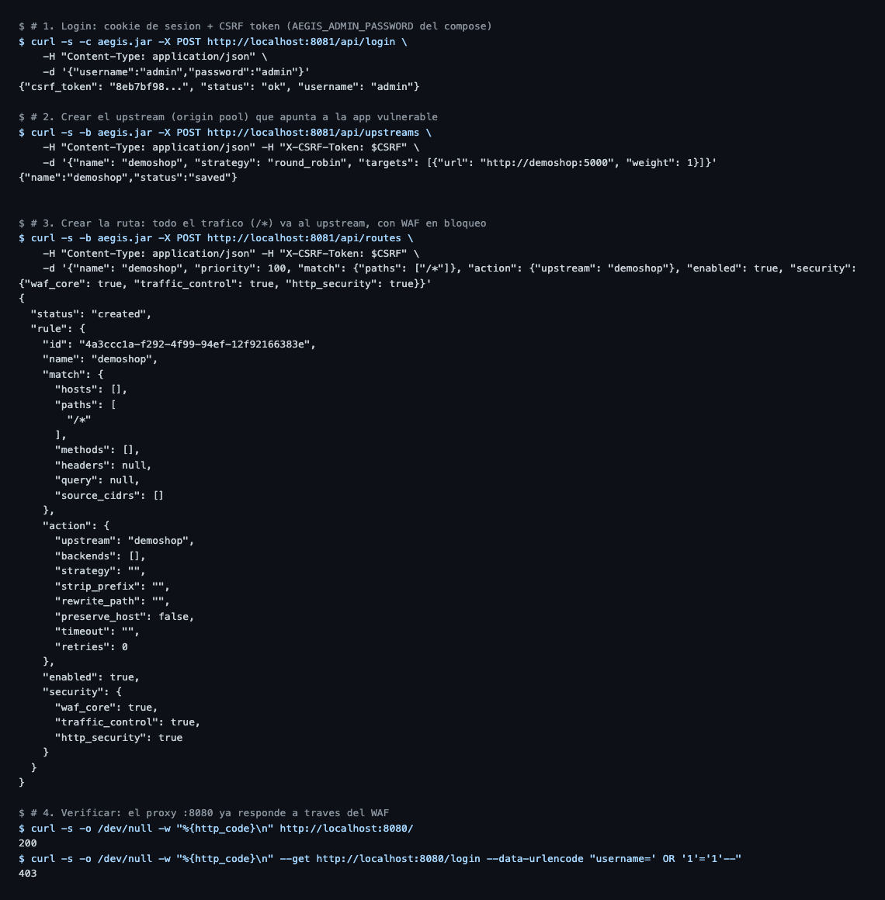
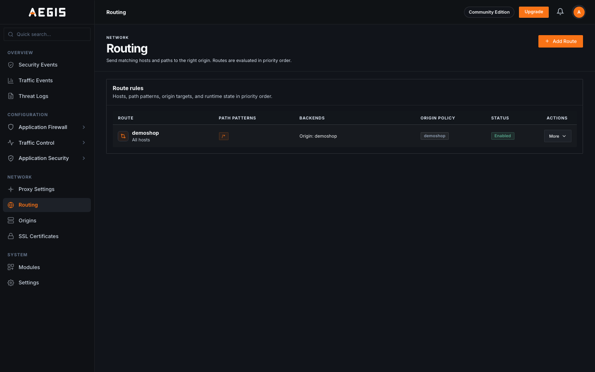

# POC — WAF en acción: antes y después con Aegis

Laboratorio para demostrar un Web Application Firewall. Se levanta una app
deliberadamente vulnerable, se la ataca, y se muestra cómo
[Aegis](https://github.com/divinelabio/Aegis) (WAF open source) bloquea esos
mismos ataques.

> ⚠️ **Solo para laboratorio.** La app es vulnerable a propósito. No la expongas
> a internet.

## Estructura

```
.
├── docker-compose.yml     # app vulnerable + Aegis + Postgres + ClickHouse
├── aegis/
│   └── config.yaml        # config de Aegis (default del release, adaptado al lab)
├── vulnapp/               # app Flask vulnerable (SQLi, XSS, path traversal)
│   ├── app.py
│   ├── Dockerfile
│   └── files/notas.txt
├── attack.py              # lanza los ataques y arma la tabla antes/después
├── alert-bridge.py        # puente ClickHouse -> webhook de Slack: alerta cada bloqueo
├── BONUS-TRACK.md         # experimentos extra: modo detección, rate limiting,
│                          # bypass, overhead de latencia, paranoia level 2,
│                          # alertas a Slack
├── POST-BORRADOR.md       # borrador del artículo del blog
└── README.md
```

## Requisitos

- Docker + Docker Compose
- Python 3.9+ con `requests` (`pip install requests`) para el script de ataque

## Pasos

### 0. Cargar la imagen de Aegis

La imagen de Aegis **no está publicada en ningún registro** (`docker pull` no
sirve). El release de GitHub trae un tarball que hay que cargar con
`docker load`. El script lo hace por vos:

```bash
./setup-aegis.sh          # usa el release 'latest'
# ./setup-aegis.sh v1.0.1 # o fijá una versión
```

Al terminar, la imagen queda disponible localmente como `aegis:local`, que es
la que usa el compose.

### 1. Levantar el stack

```bash
docker compose up -d
```

Esperá ~20s a que Postgres y ClickHouse pasen el healthcheck.

Quedan tres puertos expuestos:

| Puerto | Qué es |
|--------|--------|
| `5000` | App vulnerable **directa**, sin WAF → el "antes" |
| `8080` | App **a través de Aegis** → el "después" |
| `8081` | Consola de administración de Aegis |

### 2. Configurar la ruta en Aegis

Aegis es un reverse proxy: hay que decirle a quién proteger. Hay dos caminos:

#### Opción A — por API (reproducible, la que usa este repo)

Todo se puede hacer con `curl` contra la API de administración (`:8081`).
Primero login (devuelve cookie de sesión + CSRF token), después el upstream
(origin pool) y por último la ruta:

```bash
# 1. Login: guarda la cookie en aegis.jar y devuelve el CSRF token
curl -s -c aegis.jar -X POST http://localhost:8081/api/login \
  -H "Content-Type: application/json" \
  -d '{"username":"admin","password":"admin"}'
# -> {"csrf_token":"<UUID>","status":"ok","username":"admin"}

CSRF=<el csrf_token de la respuesta>

# 2. Upstream (origin pool) apuntando a la app vulnerable
curl -s -b aegis.jar -X POST http://localhost:8081/api/upstreams \
  -H "Content-Type: application/json" -H "X-CSRF-Token: $CSRF" \
  -d '{"name": "demoshop", "strategy": "round_robin",
       "targets": [{"url": "http://demoshop:5000", "weight": 1}]}'

# 3. Ruta: todo el tráfico (/*) va al upstream, con WAF en bloqueo
curl -s -b aegis.jar -X POST http://localhost:8081/api/routes \
  -H "Content-Type: application/json" -H "X-CSRF-Token: $CSRF" \
  -d '{"name": "demoshop", "priority": 100,
       "match": {"paths": ["/*"]},
       "action": {"upstream": "demoshop"},
       "enabled": true,
       "security": {"waf_core": true, "traffic_control": true, "http_security": true}}'
```

> ⚠️ Las mutaciones (POST/PUT/DELETE) exigen el header `X-CSRF-Token` **y** la
> cookie de sesión. Si te responde `CSRF_REQUIRED`, casi seguro estás mandando
> el header vacío o sin la cookie (`-b aegis.jar`).
>
> 📖 Referencia oficial: [Admin API](https://divinelab.io/products/aegis/docs/reference/admin-api)
> y [Routing rules](https://divinelab.io/products/aegis/docs/infrastructure/routing).
> Ojo: según la propia doc, esta API todavía **no es un contrato versionado y
> estable** — tratá los paths y payloads como detalles de implementación del
> release que estés corriendo (acá, v1.0.1).

Sesión real (login → upstream → ruta → verificación con un ataque):



Y cómo se ve el resultado en la consola (sección **Network → Routing**):



#### Opción B — por la consola web

1. Abrí `http://localhost:8081` (usuario `admin`, pass `admin`).
2. En **Origins**, creá un origin nuevo: `http://demoshop:5000`.
3. En **Routing**, creá una ruta nueva:
   - **Origin:** `demoshop`
   - **Path:** `/*`
   - **WAF:** activado, modo **bloqueo**, con el OWASP CRS.

#### Verificación rápida

```bash
curl -s -o /dev/null -w "%{http_code}\n" http://localhost:8080/                    # 200 (legitimo)
curl -s -o /dev/null -w "%{http_code}\n" --get http://localhost:8080/login \
  --data-urlencode "username=' OR '1'='1'--" --data-urlencode "password=x"          # 403 (WAF)
```

### 3. Correr los ataques

```bash
python attack.py
```

Lanza SQLi, XSS y path traversal contra `:5000` (sin WAF) y `:8080` (con WAF),
y muestra la comparación. Para exportar la tabla al post:

```bash
python attack.py --md resultados.md
```

Si cambiaste los puertos:

```bash
python attack.py --direct http://localhost:5000 --waf http://localhost:8080
```

### 4. Limpiar

```bash
docker compose down -v
```

## Qué demuestra

Sin WAF, los cuatro ataques tienen éxito (HTTP 200 + datos filtrados). Con
Aegis delante, los cuatro reciben HTTP 403 y nunca llegan a la app — mientras
que el tráfico legítimo sigue pasando sin problemas. El código vulnerable no se
toca: el WAF es una capa de defensa en profundidad, no un reemplazo de escribir
código seguro.

## Bonus track

[BONUS-TRACK.md](BONUS-TRACK.md) tiene seis experimentos para cuando el
antes/después ya te convenció: deployar en modo detección sin riesgo, rate
limiting frenando credential stuffing, una batería de bypass con ofuscaciones,
medición del overhead de latencia, qué cambia (y qué no) al subir el paranoia
level del CRS, y cómo leer el anomaly score regla por regla en la telemetría.
